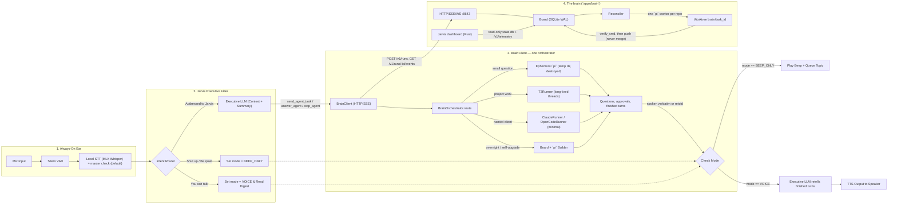

# Jarvis — Architecture

## 0. Four apps, one repository

| App         | Package / binary          | Job                                                  | Where             |
| :---------- | :------------------------ | :--------------------------------------------------- | :---------------- |
| Voice layer | `jarvis-voice` (Python)   | hears, checks speech, talks, drives agents           | `apps/voice/`     |
| Brain       | `brain` (Python)          | board, reconciler, `pi` workers, HTTP/SSE/WS gateway | `apps/brain/`     |
| Dashboard   | `jarvis-dashboard` (Rust) | fullscreen board, attempts, spend, live telemetry    | `apps/dashboard/` |
| Connect     | `Jarvis.app` (SwiftUI)    | one-button Mac mic/speaker client                    | `apps/connect/`   |

`packages/jarvis-core` holds what the apps share: `REPO_ROOT` and `JARVIS_HOME`, `.env` settings, tokens, paired
devices, project discovery, question mapping, and `SOUL.md`. `src/jarvis` is the `jarvis` CLI and supervisor that
starts, stops, and talks to the stack.

The checkout is the runtime. `jarvis` runs the brain and the voice in one process on this checkout; `jarvis start` runs
`uv sync`, rebuilds the two optional compiled artifacts (`jarvis-dashboard` with `cargo` and `Jarvis.app` with
`swiftc`), and relaunches launchd. One aiohttp app on `BRAIN_HOST:BRAIN_PORT` (default `0.0.0.0:8643`) is the only
network surface: the brain's API, dashboard telemetry, operator routes (`/v1/status`, `/v1/board`, `/v1/tasks`,
`/v1/mode`, `/v1/traces`, `/v1/restart`), and remote audio (`/ws`, `/client.py`, `/Jarvis.app.zip`, `/install-app`).
Unauthenticated routes are limited to `/health` and the client bootstrap (`/client.py`, `/Jarvis.app.zip`,
`/install-app`, `POST /v1/pair/request`, `POST /v1/pair`). Paired device secrets (`JARVIS_HOME/devices.json`) work only
on `GET /v1/status` and `/ws`. Every other route requires the owner token (`BRAIN_API_KEY` or `JARVIS_HOME/brain_token`;
on `/ws`, `REMOTE_TOKEN` overrides the shared token when set). One machine, one board, one SQLite writer, and one client
at a time on the mic.

Each language keeps its native workspace (`uv`, `cargo`; `pnpm`/`go.work` when a client or service in another
language arrives), so a new app is a folder and a workspace line. Cross-language contracts live in `schemas/`.

## 1. Core Requirements

1. **Always-On (No Wake Word), Respond Only When Needed:** Continuously listen without requiring *"Hey Jarvis"*, while distinguishing between self-talk/background conversation and utterances actually addressed to Jarvis.
2. **Multi-Agent Orchestration:** The voice routes every task that needs doing to **the brain** (`brain`), which
   always runs alongside it. The brain decides the runner: coding and project work in a **T3 Code** thread, a small
   question in a one-shot `pi` worker, a named Claude Code or OpenCode turn in that client, and overnight or
   self-upgrade work on its board. Jarvis only routes and relays; the work happens in each runner's own harness.
3. **Plain-Words Reporting:** Agent questions and approval requests are read out as they are. A finished turn is long markdown full of file paths and diffs; Jarvis has its conversation model retell it as one short first-person outcome, about ten words; a plan or choice waiting on the user gets one phrase per heading, then its question (`AGENT_REPORT_PROMPT`).
4. **Dynamic Silence / Notification Mode:**
   - Saying **"Shut up"** or **"Be quiet"** immediately silences Jarvis's voice (`BEEP_ONLY` mode), interrupting any active speech and using short audio chimes ("beep") to notify when new agent decisions arrive.
   - Saying **"You can talk"** restores `VOICE` mode and reads out a concise digest of queued topics.
   - **"Stop" stops the work, "shut up" mutes Jarvis.** "Stop it", "stop that" and "cancel that" reach the
     conversation model, which calls `stop_agent`; agents keep working while Jarvis is muted.

---

## 2. System Architecture Diagram

---

## 3. Stack

### A. Real-Time Voice Pipeline Framework
* **[Pipecat](https://github.com/pipecat-ai/pipecat) (Python)**
  * **Why:** Frame-based architecture makes it trivial to insert custom gates (`JarvisIntentGate`) directly into the audio/transcription stream. Supports instant interruption (`InterruptionFrame`), raw PCM beep injection (`OutputAudioRawFrame`), and direct TTS synthesis (`TTSSpeakFrame`).

### B. "No Wake Word"
Without a wake word, two local filtering stages prevent false triggers and API cost blowups:
0. **Echo cancellation:** `MacVoiceTransport` (`mac_audio.py`) replaces Pipecat's PyAudio transport. One `AVAudioEngine` with macOS voice processing on owns both the mic tap and the speaker player, because Apple cancels only the echo of what plays through the same engine. The mic arrives as float32 at 48 kHz and is resampled to 16 kHz; playback is paced to real time with about 80 ms queued, so an interruption cuts Jarvis off. `jarvis enroll` records through the same engine, so the voiceprint matches what Jarvis hears. Research and numbers: `docs/research/echo-cancellation.md`.
   A paired Mac's mic and speaker reach Jarvis on the same HTTP server as everything else: `RelayHub` and
   `RemoteVoiceTransport` (`remote_audio.py`) serve `/ws` and `/client.py`, and the socket carries 16-bit mono PCM
   at 16 kHz both ways (local speech is 24 kHz and resampled for it). The *client* runs the same `AVAudioEngine`
   voice processing (`defaults/remote/client.py`) — the canceller has to sit where the speaker is, or Jarvis hears
   itself and barge-in dies. The heavy half never moves: Whisper, the speech check, the agents and memory all stay
   on the Mac running Jarvis. The routes are **always mounted**; `MacVoiceTransport` holds a `RelayHub` and shares
   an `Ear` with it: a client that connects takes the mic and speaker, speaking on either Mac moves the ear to that
   one, and this Mac takes it back when the client goes. With no local audio hardware (a headless Mac mini), the transport starts without one,
   `has_local_audio` is false, and Jarvis waits for a client before greeting. Output is paced exactly like the local
   transport, and an `InterruptionFrame` sends a `flush` so the other Mac drops what it still had queued. The port
   is on the network, so every connection carries the shared token (`brain_token`, or `remote_token` /
   `REMOTE_TOKEN`) or a paired device's secret, and only one client at a time, since they share one ear.
1. **VAD (Voice Activity Detection):** **[Silero VAD](https://github.com/snakers4/silero-vad)** detects human speech boundaries locally in `<1ms`.
2. **Local STT + Master Check:** **[MLX Whisper](https://github.com/ml-explore/mlx-examples/tree/main/whisper)**
   (`mlx-community/whisper-large-v3-turbo` for `en`; `sangdth/phowhisper-large-vien-cs-mlx-16bit` for `vi`) transcribes
   speech locally on the Apple GPU at $0 cost. With `MASTER_CHECK=true` (on by default; `jarvis enroll` resets the
   voiceprint, `MASTER_CHECK=false` turns the check off), a [sherpa-onnx](https://github.com/k2-fsa/sherpa-onnx)
   speaker embedding (3D-Speaker ERes2Net, ~100 ms, run alongside Whisper) scores the whole sentence against
   `JARVIS_HOME/owner_voice.npy` and drops speech below `SPEAKER_THRESHOLD`, except mute/unmute phrases or `[Room]`
   speech in meeting mode. Turns come only from verified sentences (`ExternalUserTurnStrategies` + `JarvisIntentGate`),
   so background voices never interrupt Jarvis or hold a turn open. With `SAVE_SEGMENTS=N` (off by default), every
   segment Whisper receives — even no-text drops — is saved as a WAV in `JARVIS_HOME/clips` (0700/0600, newest N) and
   named on the `[Speaker] score=` log line. Research: `docs/research/speaker-verification.md`.
3. **Turn Detection:** With `SMART_TURN=true` (default), a 0.2 s pause asks Pipecat's Smart Turn v3 (local ONNX,
   ~50 ms) whether the voice sounds finished; if not, `SpeakerVerifiedWhisperSTT` keeps the sentence open until speech
   resumes or 1.5 s of silence pass (capped at `MAX_HELD_SECS = 30`). With `SMART_TURN=false`, every 0.6 s pause ends
   a sentence, and trailing `"..."` / dashes wait up to `HOLD_SECS = 2.0` once to join the continuation. Answered turns
   log `[Latency]` lines (`latency.py`, `UserBotLatencyObserver`) and `[Intent] ... ms`.
4. **Speech Check (Laya + Fallback):** Fixed phrases ("shut up", "you can talk", "meeting mode on/off") match locally
   (`state.classify_fast_command`). Everything else goes to Laya's `jarvis-intent` (`POST $LAYA_BASE_URL/v1/systemone`,
   ~90 ms), labeling `MUTE`, `UNMUTE`, `ADDRESSED_TO_JARVIS`, or `IGNORE_BACKGROUND`. OpenRouter's `FILTER_MODEL`
   (`typesafe/jev-1.14`, `/api/alpha/decisions`, ~230 ms) is queried in parallel and used if Laya fails or exceeds
   `LAYA_TIMEOUT_SECS`. Both decisions and inferred user corrections append to `JARVIS_HOME/feedback/intent.jsonl`.
5. **Transcript Cleanup:** Passed sentences run through `TranscriptCleaner` (`cleanup.py`, `TRANSCRIPT_CLEANUP`) before
   `[Room]` / `[Speaker: ...]` / `[Meeting transcript:` tags are added. One non-thinking `CLEANUP_MODEL` call (1.5 s
   cap) fixes punctuation, strips fillers, and resolves in-sentence slips while keeping opening `"No, sorry,"`
   replacements. Sentences of 18 words or fewer (`SHORT_WORDS = 18`) skip cleanup unless they contain a stutter
   (repeated word), a filler, or a `CLEANUP_CUES` phrase; `[Cleanup] ... ms` logs the timing.

### C. Agent Integration (Claude Code, OpenCode, the brain, T3 Code)
Instead of fragile terminal/tmux scraping, Jarvis connects via structured JSON protocols:
Each agent has three actions, one LLM tool each: `send_agent_task` (new work), `answer_agent` (reply to the question
or approval the agent is waiting on) and `stop_agent`. An answer never becomes a new prompt, and a task never answers
a pending question. With no agent named, a task goes to the default coding agent, an answer to the agent
that asked last, and a stop to the agent that is working. For every coding client (T3 Code, Claude Code, OpenCode,
Pi), `send_agent_task` also takes `session` (`"new"`, or the user's words naming an earlier session, matched against
session titles, branches and folders) and `project` (a listed folder: its newest session there that is not running,
or a new one), so the next task goes to that session, and its result names that session. `list_sessions` returns
a client's session titles, project, time, and which is running or current. A connected session (`jarvis connect`)
ignores `session` and `project`.

1. **Claude Code (`ClaudeRunner`, `apps/brain/src/brain/runners/claude.py`):** Minimal `claude -p --output-format json`
   runner with the user's own Claude settings and permission mode (Jarvis sets none), resuming `--resume <session id>`
   across turns and reading session titles directly from `~/.claude/projects/*/*.jsonl` for `jarvis connect claude`.
2. **OpenCode (`OpenCodeRunner`, `apps/brain/src/brain/runners/opencode.py`):** Minimal `opencode run --format json`
   runner when the owner names OpenCode or attaches via `jarvis connect opencode`, continuing `--session <id>` in the
   project folder and listing sessions through `opencode api GET /session`.
3. **The brain (`BrainClientAdapter`, type `brain`):** The voice's one agent. It talks to Brain on
   `127.0.0.1:8643` (Bearer `BRAIN_API_KEY`, else `JARVIS_HOME/brain_token`) with the protocol below, which
   Brain serves from `apps/brain/src/brain/server.py`. A task is `POST /v1/runs` with `input` (and optionally
   `pinned`, `session`, `cwd`, `replace`, `screenshot`); later tasks pass the first run's id as `session_id`.
   Each run's `GET /v1/runs/:id/events` stream gives `approval.request` / `question.request` (read out; answered
   with `POST /v1/runs/:id/answer`, free text mapped deterministically), `session.switched` (the thread changed),
   and `run.completed` / `run.failed` (retold); `run.cancelled` is silent. If the stream drops,
   `GET /v1/runs/:id` gives the result. Stop is `POST /v1/runs/:id/stop`. `GET /v1/events` carries events no voice
   run is waiting on (including `jarvis connect` watched T3 threads). Inside Brain, `BrainOrchestrator.route` picks the
   runner: a one-shot `pi` worker for a small question, a long-lived T3 thread for project work (auto-starting
   `t3 serve` on loopback), a minimal Claude/OpenCode turn when the owner names one, or the board. The reconciler still
   decides which board work waits for the owner. The whole contract is `schemas/openapi.json`.
4. **T3 Code (`T3Runner`, `apps/brain/src/brain/runners/t3.py`):** Driven behind `POST /v1/runs` and `POST /v1/connect`,
   talking to the running T3 Code app over `ws://127.0.0.1:3773/ws`
   (`?orchestrationProtocol=2`), the API the T3 window itself uses: Effect RPC messages as JSON (`Request`, `Exit`,
   `Chunk`, and an `Ack` for every chunk). Auth is a 30-day bearer token from
   `t3 auth session issue --scope orchestration:read --scope orchestration:operate`, issued once per run and again
   only after a 401/403. Its sessions are the user's threads in the T3 project holding a folder
   (`orchestration.subscribeShell`, `recent_threads`). The folder is `cwd`, or a `project` the conversation model
   picks from the git repos under `projects_dir` from `JARVIS_HOME/SOUL.md`, default `~/Projects/`
   (`list_projects`). The first task continues the newest thread there that is not running; with none, or after a
   new session, it starts a thread (`orchestration.launchThread`, `generateTitle`) with the user's T3 default model
   and runtime mode, whose first message is "Sync with the master branch first. Then: <task>". A project folder T3
   doesn't know yet is added with `project.create`. `T3Runner` watches active and `jarvis connect` threads; tasks are
   `message.dispatch` with `deliveryIntent: "auto"`, like a send in the T3 window. `orchestration.subscribeThread`
   (resumed with `afterSequence`) gives `run.updated`, finished `assistant_message` items (retold when the run
   completes) and `approval_request` / `user_input_request` items (read out; answered with `runtime-request.respond`,
   or queued in `outbox` when deferred). Stop is `run.interrupt` scoped to that run's thread. A 426 means T3 changed its
   protocol version.

### D. Executive Filter & Mute State Machine
1. **What reaches the user:** Watchers only pass on questions, approvals and finished turns. Questions and approvals
   are spoken as they are. A finished turn (long markdown) goes to the executive LLM as an `AGENT_REPORT_PROMPT`
   message, which retells it as one short first-person outcome per turn and calls no tool; approvals never go through the LLM, so it can't
   approve anything on its own. Offline, Jarvis reads the turn's last line. While a sent task runs,
   `remind_while_busy` says a short "still working on it" line now and then; a new task restarts the count. The
   lines are written per task by `EXECUTIVE_MODEL` (`waiting_lines.py`, `WAITING_PROMPT`) from the `languages.json`
   `waiting` lines and the user's task, 6 at a time, with the next batch started after 4 are spoken; the base lines
   are spoken as they are only when a call fails.
2. **Long-term memory (`memory.py`):** Pipecat's `Mem0MemoryService` sits just before the executive LLM. Before
   each reply it searches local Mem0 (Qdrant on disk, Ollama `bge-m3`, ~22 ms) and adds what it finds; after each
   reply it saves the newest exchange in the background, where `EXTRACTION_MODEL` (default `deepseek/deepseek-v4.1-flash`, thinking off) picks out the facts.
3. **Mute / Beep State Machine (`JarvisState`):**
   * **`VOICE` Mode:** Important agent topics are spoken immediately via TTS.
   * **`BEEP_ONLY` Mode (triggered by *"Shut up"*, *"Be quiet"*, *"Stop talking"*, *"Hush"*):** Active TTS is immediately cancelled, a low confirmation tone plays, and incoming agent topics are appended to `pending_topics` while playing a short 880Hz sine chime.
   * **Unmute Digest (triggered by *"You can talk"*):** Restores `VOICE` mode, reads out queued questions, then has the LLM retell queued finished turns.

### E. Brain timers, memory and outbox delivery
1. **Timers (`schedule.py`, `timers` table):** `jarvis remind`, `jarvis schedule`, voice phrasing ("remind me … in 30
   minutes", "every weekday at 8am …") and `POST /v1/timers` write one row: a one-shot `followup` or a five-field
   cron `schedule` read in its own IANA zone. `Reconciler.tick` advances a due row atomically (`firing`), creates a
   board task (`action='task'`) or starts a short read-only `pi` check beside the loop (`action='check'`), and returns
   a schedule to `active` at its next occurrence. A missed slot is skipped, never replayed in a burst; a crash is
   recovered after a grace period.
2. **Memory (`memory.py`):** `INSTRUCTIONS.md` is the owner's, read-only to workers; `memory/MEMORY.md` is a
   <=150-line index injected into every planner/builder run with `--append-system-prompt`; repository detail lives in
   `memory/repos/<slug>.md`. Progress notes now record verified results as well as failures. Only the offline
   Improver writes the two curated files (with `expected_sha256`), and its reflection pass corrects stale notes
   against the traces.
3. **Outbox delivery (`server.py`, `brain_client.py`):** in `ASSIST` mode a queued outbox row is published on
   `GET /v1/events`; the voice speaks it and acknowledges `POST /v1/outbox/{id}/spoken`, which writes one line to
   `memory/reported.md`. In `AUTONOMOUS` mode nothing is spoken until the owner switches back or asks for the brief.
   A reconnecting voice drains `GET /v1/outbox?status=queued` first, so a slept Mac does not lose the night's work.
4. **Durable traces (`traces.py`):** `TraceSink` drains the same telemetry bus into
   `traces/<YYYY-MM-DD>/spans.jsonl` + `trace-<trace_id>.json` and a `trace_runs` row (surface, outcome, implicit
   friction, `git_sha`, `prompt_sha`, cost, `trace_path`). `distill_experience` turns those rows into
   `traces/analysis/overview.md` + `surfaces/<surface>.md` for the offline Improver; `jarvis traces` and the
   dashboard's startup read the rows, so a restart no longer erases the last turns. Local only, no extra daemon;
   `OTEL_EXPORTER_OTLP_ENDPOINT` optionally mirrors spans over OTLP/HTTP.

---

## 4. Codebase Mapping

### Root CLI and shared core (`src/jarvis/` and `packages/jarvis-core/src/jarvis_core/`)

| File                                        | What it holds                                                 |
| :------------------------------------------ | :------------------------------------------------------------ |
| `src/jarvis/cli.py`                         | `jarvis` commands (service, init, HTTP calls), one-mic lock   |
| `src/jarvis/init.py`                        | `jarvis init`: defaults, brain folder, tokens, `SOUL.md`      |
| `src/jarvis/supervisor.py`                  | Runs brain + voice in one process; shares Qdrant/telemetry    |
| `src/jarvis/defaults/`                      | Shipped `agents.json` and `env.example`                       |
| `jarvis_core/{home,settings,soul}.py`       | `JARVIS_HOME`, `REPO_ROOT`, `.env` base, `SOUL.md` I/O        |
| `jarvis_core/{devices,net}.py`              | Paired device store (`devices.json`), advertised LAN hosts    |
| `jarvis_core/{projects,questions}.py`       | Repo discovery (`list_projects`), deterministic answer maps   |
| `jarvis_core/{sessions,t3}.py`              | Shared session matching (`match_sessions`), T3 helpers        |

### Voice layer (`apps/voice/src/jarvis_voice/`)

| File                                        | What it holds                                                 |
| :------------------------------------------ | :------------------------------------------------------------ |
| `main.py`                                   | Pipecat pipeline wiring, TTS, `jarvis connect` picker         |
| `prompts.py`, `languages.json`              | System, retell, greeting prompts; per-language rules (`en`/`vi`) |
| `system_prompts.py`                         | Optional `SYSTEM.md` overrides (`cleanup`, `retell`, `waiting`) |
| `agent_tools.py`                            | Tool schemas/handlers (`send_agent_task`, `rename_speaker`, …) |
| `config.py`                                 | Voice `Settings` from `.env`, Whisper models, gateway URL     |
| `mac_audio.py`, `voice_engine.py`           | `AVAudioEngine` voice processing transport + standalone audio |
| `remote_audio.py`, `defaults/remote/`       | `RelayHub` + `RemoteVoiceTransport` (`/ws`, `/client.py`)     |
| `meet_voice.py`, `defaults/meet/`           | Google Meet Chrome extension audio bridge (`127.0.0.1:47123`) |
| `voice_gates.py`                            | `SpeakerVerifiedWhisperSTT`, `JarvisIntentGate`               |
| `speaker.py`, `enroll.py`                   | sherpa-onnx embeddings, `SpeakerBeliefTracker`, `jarvis enroll` |
| `executive_filter.py`, `feedback.py`        | Laya + OpenRouter speech check, `feedback/intent.jsonl`       |
| `cleanup.py`, `latency.py`                  | `TranscriptCleaner`, per-turn `[Latency]` breakdown           |
| `state.py`, `waiting_lines.py`              | `JarvisState` (mute/meeting), fast commands, waiting lines    |
| `meeting_notes.py`, `screen.py`             | Meeting comments (`meeting/<date>.md`), front-window capture  |
| `agent_adapter.py`, `sessions.py`           | `BaseAgentAdapter`, `CodingSessionAdapter`                    |
| `brain_client.py`, `orchestrator.py`        | `BrainClientAdapter` (shipped default), `AgentOrchestrator`   |
| `pi_adapter.py`                             | Open Pi window adapter (`jarvis connect pi`)                  |
| `memory.py`, `llm.py`, `telemetry.py`       | Local Mem0 (`LastExchangeMemory`), `JarvisLLM`, stage events  |

### Brain (`apps/brain/src/brain/`)

| File                                        | What it holds                                                 |
| :------------------------------------------ | :------------------------------------------------------------ |
| `server.py`, `cli.py`, `config.py`          | Gateway HTTP/SSE server, `brain` CLI helpers, settings        |
| `orchestrator.py`                           | Fast-paths + OpenRouter tool router across runners/board      |
| `runners/{base,ephemeral_pi,t3,claude,opencode}.py` | `Runner` protocol, one-shot `pi`, T3 WS RPC, lazy clients |
| `reconciler.py`, `pi_stream.py`             | Board loop, worktree workers, self-upgrade gates, JSON stream |
| `db.py`, `schema.sql`                       | SQLite WAL store (9 tables + `trace_fts` FTS5)                |
| `sandbox.py`, `defaults/pi/board.ts`        | macOS Seatbelt profiles, Pi extension (`edit_and_run`, RPC)   |
| `schedule.py`, `upgrade.py`                 | Cron/one-shot timers, divergence-safe git state helper        |
| `memory.py`, `skills.py`                    | Curated `MEMORY.md`, repo notes, skill lift + rollback        |
| `traces.py`, `telemetry.py`                 | `TraceSink`, friction detector, digest, `TelemetryHub`        |
| `evals.py`, `pareto.py`, `weights.py`       | `held_in`/`held_out` harvest, Pareto selector, weight links   |

### Dashboard and Connect

- **Dashboard (`apps/dashboard/`):** Rust + Ratatui fullscreen UI (`db.rs`, `http.rs`, `app.rs`, `ui/*.rs`). Details in
  `apps/dashboard/README.md`.
- **Connect (`apps/connect/`):** SwiftUI Mac mic/speaker app (`JarvisApp.swift`, `AppModel.swift`, `ApiClient.swift`,
  `AudioRelay.swift`, `build.sh`). Details in `apps/connect/README.md`.
