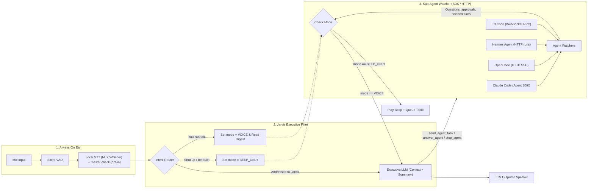

# Jarvis — Architecture

## 1. Core Requirements

1. **Always-On (No Wake Word), Respond Only When Needed:** Continuously listen without requiring *"Hey Jarvis"*, while distinguishing between self-talk/background conversation and utterances actually addressed to Jarvis.
2. **Multi-Agent Orchestration:** Route each request by the agents' `role` in `agents.json`: coding to **T3 Code** (or **Claude Code** or **OpenCode** when named), everything else to **Hermes Agent**. Jarvis only routes and relays; the work happens in each agent's own harness.
3. **Plain-Words Reporting:** Agent questions and approval requests are read out as they are. A finished turn is long markdown full of file paths and diffs; Jarvis has its conversation model retell it as one short first-person outcome, about ten words; a plan or choice waiting on the user gets one phrase per heading, then its question (`AGENT_REPORT_PROMPT`).
4. **Dynamic Silence / Notification Mode:**
   - Saying **"Shut up"** or **"Be quiet"** immediately silences Jarvis's voice (`BEEP_ONLY` mode), interrupting any active speech and using short audio chimes ("beep") to notify when new agent decisions arrive.
   - Saying **"You can talk"** restores `VOICE` mode and reads out a concise digest of queued topics.
   - **"Stop" stops the work, "shut up" mutes Jarvis.** "Stop it", "stop that" and "cancel that" reach the
     conversation model, which calls `stop_agent`; agents keep working while Jarvis is muted.

---

## 2. System Architecture Diagram

> [!TIP]
> A visual architecture map is stored in [docs/architecture-map.html](architecture-map.html) (standalone interactive view) and [docs/assets/architecture-map.png](assets/architecture-map.png).

---

## 3. Stack

### A. Real-Time Voice Pipeline Framework
* **[Pipecat](https://github.com/pipecat-ai/pipecat) (Python)**
  * **Why:** Frame-based architecture makes it trivial to insert custom gates (`JarvisIntentGate`) directly into the audio/transcription stream. Supports instant interruption (`InterruptionFrame`), raw PCM beep injection (`OutputAudioRawFrame`), and direct TTS synthesis (`TTSSpeakFrame`).

### B. "No Wake Word"
Without a wake word, two local filtering stages prevent false triggers and API cost blowups:
0. **Echo cancellation:** `MacVoiceTransport` (`mac_audio.py`) replaces Pipecat's PyAudio transport. One `AVAudioEngine` with macOS voice processing on owns both the mic tap and the speaker player, because Apple cancels only the echo of what plays through the same engine. The mic arrives as float32 at 48 kHz and is resampled to 16 kHz; playback is paced to real time with about 80 ms queued, so an interruption cuts Jarvis off. `jarvis enroll` records through the same engine, so the voiceprint matches what Jarvis hears. Research and numbers: `docs/research/echo-cancellation.md`.
1. **VAD (Voice Activity Detection):** **[Silero VAD](https://github.com/snakers4/silero-vad)** detects human speech boundaries locally in `<1ms`.
2. **Local Always-On STT + Turn Classifier:** **[MLX Whisper](https://github.com/ml-explore/mlx-examples/tree/main/whisper)** (`mlx-community/whisper-large-v3-turbo`) transcribes speech locally on the Apple GPU at $0 cost. With `MASTER_CHECK=true` (off by default; `jarvis enroll` turns it on), in the same step a [sherpa-onnx](https://github.com/k2-fsa/sherpa-onnx) speaker embedding (3D-Speaker ERes2Net, about 100 ms, run alongside Whisper) compares the whole sentence with the enrolled voiceprint (`~/.config/jarvis/owner_voice.npy`); below `SPEAKER_THRESHOLD` the sentence is dropped, unless it is a mute or unmute phrase. Turns come only from sentences that pass both checks: the user aggregator runs on Pipecat's `ExternalUserTurnStrategies`, and `JarvisIntentGate` wraps each passed sentence in proposed start/stop frames, so background voices never interrupt Jarvis or hold a turn open. Voice detection still cuts Whisper's sentences: with `SMART_TURN=true` (default) a 0.2 s pause asks Pipecat's Smart Turn v3 (local ONNX, about 50 ms) whether the voice sounds finished; if not, `SpeakerVerifiedWhisperSTT` keeps the sentence open until the user goes on or 1.5 s of silence pass, so Whisper and the voice check get it whole; a sentence held past 30 s (`MAX_HELD_SECS`, a TV that never sounds done) goes on as it is. With `SMART_TURN=false` every 0.6 s pause ends a sentence, and one Whisper ends with "..." or a dash waits up to 2 s after the user's next silence and joins what they say next, once (`HOLD_SECS`). Research: `docs/research/speaker-verification.md`. Each answered turn logs `[Latency]` lines (Pipecat's `UserBotLatencyObserver`, `enable_metrics` on; `latency.py` skips cycles with no released user turn) and `[Intent] ... ms` for the speech check, which Pipecat counts inside transcription. With `SAVE_SEGMENTS=N`, every segment Whisper gets (even one it returns no text for) is saved as a WAV in `JARVIS_HOME/clips` (folder 0700, files 0600, newest N kept) and named on its `[Speaker] score=` log line, to re-run Whisper and the voice check on real misses; off by default. Fixed phrases ("shut up", "you can talk") are caught by a local pattern; everything else goes to Laya's `jarvis-intent` (`POST $LAYA_BASE_URL/v1/systemone`, one `choice` question, fine-tuned for Jarvis, about 90 ms), which labels it `MUTE`, `UNMUTE`, `ADDRESSED_TO_JARVIS`, or `IGNORE_BACKGROUND`. The OpenRouter decision model `typesafe/jev-1.14` (`FILTER_MODEL`, `POST /api/alpha/decisions`, about 230 ms) gets the same question at the same time; its answer is used only when Laya fails or passes `LAYA_TIMEOUT_SECS`, and both answers go to `feedback/intent.jsonl` for retraining.

### C. Agent Integration (Claude Code, OpenCode, Hermes, T3 Code)
Instead of fragile terminal/tmux scraping, Jarvis connects via structured JSON protocols:
Each agent has three actions, one LLM tool each: `send_agent_task` (new work), `answer_agent` (reply to the question
or approval the agent is waiting on) and `stop_agent`. An answer never becomes a new prompt, and a task never answers
a pending question. With no agent named, a task goes to the default coding agent, an answer to the agent
that asked last, and a stop to the agent that is working. For Claude Code, OpenCode and Pi, `send_agent_task` also
takes `session` (`"new"`, or the user's words naming an earlier session, matched against session titles, branches
and folders) and `project` (a listed folder: its newest session there, or a new one), so the next task goes to
that session. A connected session (`jarvis connect`) ignores both.

1. **Claude Code (`ClaudeCodeAdapter`):** One `ClaudeSDKClient` (Python `claude-agent-sdk`) per session, with
   the user's own Claude settings and permission mode (Jarvis sets none). It starts with `resume=<session id>`: the
   id from the CLI's `init` message, or the one `jarvis connect claude` picked from `list_sessions` (every folder,
   newest first). A crash restarts the process on the same id, and a crash mid-turn is said out loud. Picking or
   starting a session restarts the process, so neither happens while a turn runs. Tool permissions and `AskUserQuestion` arrive in
   `can_use_tool`; Jarvis reads them out and the agent waits for `answer_agent`. A turn ends with a `ResultMessage`.
   `stop_agent` calls `interrupt()` and denies any pending question.
2. **OpenCode (`OpenCodeSSEAdapter`):** Talks to the service OpenCode 2 registers in
   `~/.local/state/opencode/service.json` (`discover_service`, read before each connect since a restart picks a new
   port). The file is trusted only when it is the user's own, not a symlink, unreadable to others, names a loopback
   URL and a live pid. `OPENCODE_SERVER_PASSWORD` or a custom `url` pins a user-started `opencode serve` instead. Auth
   is HTTP Basic (`opencode` / password). Events come from `GET /api/event`; 45 s without bytes (heartbeats arrive
   every 15 s) means a dead stream and a reconnect. After each connect it re-reads `GET /api/permission/request` and
   `GET /api/form`, since events are not replayed. It surfaces `permission.asked`, `form.created` and the last text of
   each finished run, and drops a pending request on `permission.replied`, `form.replied` or `form.cancelled`.
   The shared service streams every session on the Mac, so Jarvis keeps to its `cwd`: listings carry
   `x-opencode-directory`, new sessions get `location.directory`, and an unknown session's events count only after
   one `GET /api/session/:id` shows it is in `cwd` (`_is_ours`); otherwise Jarvis could approve tool calls in other
   projects. Within `cwd` it follows one session: the first it sees, the one `jarvis connect opencode` picked from
   `GET /api/session` (which moves `cwd` to that session's folder), or a new one from `POST /api/session`. Events
   from other sessions (sub-agents run in child sessions) do not end the turn. Tasks go to that session
   (`POST /api/session/:id/prompt`); answers go to
   `.../permission/:requestID/reply` or `.../form/:formID/reply`; stop is `POST /api/session/:id/interrupt`.

3. **Hermes Agent (`HermesAdapter`):** Talks to the Hermes API server (`hermes gateway`, port 8642, Bearer
   `HERMES_API_KEY`). A task is `POST /v1/runs` with `input`, and later tasks pass the first run's id as
   `session_id`, so Hermes keeps the conversation. Each run's `GET /v1/runs/:id/events` stream gives
   `approval.request` (read out; answered with `POST /v1/runs/:id/approval`, `once` or `deny`) and
   `run.completed` / `run.failed` (retold); `run.cancelled` is silent. If the stream drops, `GET /v1/runs/:id`
   gives the result. Stop is `POST /v1/runs/:id/stop`. Hermes's guardian model decides which commands need a human.
4. **T3 Code (`T3Adapter`, `t3_adapter.py`):** Talks to the running T3 Code app over `ws://127.0.0.1:3773/ws`
   (`?orchestrationProtocol=2`), the API the T3 window itself uses: Effect RPC messages as JSON (`Request`, `Exit`,
   `Chunk`, and an `Ack` for every chunk). Auth is a 30-day bearer token from
   `t3 auth session issue --scope orchestration:read --scope orchestration:operate`, issued once per run and again
   only after a 401/403. A task looks up the T3 project holding its folder (`orchestration.subscribeShell`) and
   starts a thread (`orchestration.launchThread`) with the user's T3 default model and runtime mode. The folder is
   `cwd`, or a `project` the conversation model picks from the git repos under `projects_dir` from `~/.config/jarvis/SOUL.md`, default `~/Projects/` (`list_projects`); a
   project folder T3 doesn't know yet is added with `project.create`, and its thread opens with only "Sync with the master
   branch." (the model's task is not sent; later requests go to that thread). Jarvis watches one thread, the newest, or the one `jarvis connect` attached (`current_thread` from the T3 project script's folder env, else picked from `recent_threads`); later tasks for the same folder are `message.dispatch` with `deliveryIntent: "auto"`, like a send in the T3 window. `orchestration.subscribeThread`
   (resumed with `afterSequence`) gives `run.updated`, finished `assistant_message` items (retold when the run
   completes) and `approval_request` / `user_input_request` items (read out; answered with `runtime-request.respond`).
   Stop is `run.interrupt`. A 426 means T3 changed its protocol version.

### D. Executive Filter & Mute State Machine
1. **What reaches the user:** Watchers only pass on questions, approvals and finished turns. Questions and approvals
   are spoken as they are. A finished turn (long markdown) goes to the executive LLM as an `AGENT_REPORT_PROMPT`
   message, which retells it as one short first-person outcome per turn and calls no tool; approvals never go through the LLM, so it can't
   approve anything on its own. Offline, Jarvis reads the turn's last line. While a sent task runs,
   `remind_while_busy` says a short "still working on it" line now and then; a new task restarts the count. The
   lines are written per task by `EXECUTIVE_MODEL` (`waiting_lines.py`, `WAITING_PROMPT`) from the `languages.json`
   `waiting` lines and the user's task, 6 at a time, with the next batch started after 4 are spoken; the base lines
   are spoken as they are only when a call fails.
2. **Long-term memory (`memory.py`):** Pipecat's `Mem0MemoryService` sits just before the executive LLM. Before
   each reply it searches local Mem0 (Qdrant on disk, Ollama `bge-m3`, ~22 ms) and adds what it finds; after each
   reply it saves the newest exchange in the background, where `EXTRACTION_MODEL` (default `deepseek/deepseek-v4.1-flash`, thinking off) picks out the facts.
3. **Mute / Beep State Machine (`JarvisState`):**
   * **`VOICE` Mode:** Important agent topics are spoken immediately via TTS.
   * **`BEEP_ONLY` Mode (triggered by *"Shut up"*, *"Be quiet"*, *"Stop talking"*, *"Hush"*):** Active TTS is immediately cancelled, a low confirmation tone plays, and incoming agent topics are appended to `pending_topics` while playing a short 880Hz sine chime.
   * **Unmute Digest (triggered by *"You can talk"*):** Restores `VOICE` mode, reads out queued questions, then has the LLM retell queued finished turns.

---

## 4. Codebase Mapping

All files are in `src/jarvis/`.

| File                  | What it holds                                                              |
| :-------------------- | :------------------------------------------------------------------------- |
| `main.py`             | Pipeline wiring, TTS, `jarvis connect` thread and session pick             |
| `prompts.py`          | System prompt, agent roster, project list, retell and greeting prompts     |
| `languages.json`      | Per-language prompt rules and fixed spoken lines (`en`, `vi`)              |
| `agent_tools.py`      | `send_agent_task`, `answer_agent`, `stop_agent` schemas and handlers       |
| `cli.py`              | `jarvis` commands (`init`, `enroll`, `connect`, `update`), one-mic lock    |
| `config.py`           | `Settings` from `.env`, `JARVIS_HOME`, dev checkout vs. installed          |
| `soul.py`             | `SOUL.md` read and write                                                   |
| `init.py`             | `jarvis init`: copies the defaults, asks for keys, writes `SOUL.md`        |
| `mac_audio.py`        | `MacVoiceTransport`: mic and speaker through macOS voice processing        |
| `voice_gates.py`      | `SpeakerVerifiedWhisperSTT`, `JarvisIntentGate`                            |
| `speaker.py`          | sherpa-onnx speaker embeddings, voiceprint load and save, model download   |
| `enroll.py`           | `jarvis enroll`: records the owner's voiceprint, sets `MASTER_CHECK=true`  |
| `executive_filter.py` | `ExecutiveFilter`: decision model, `INTENT_QUESTION`                       |
| `state.py`            | `JarvisState` (`VOICE`, `BEEP_ONLY`), mute and unmute patterns, beep synth |
| `agent_adapter.py`    | `BaseAgentAdapter`, `WatchedAgentConfig`, spoken answer to form, approval  |
| `sessions.py`         | `CodingSessionAdapter` (list, pick, new session), `match_sessions`         |
| `claude_adapter.py`   | `ClaudeCodeAdapter`: Claude Code through the Agent SDK                     |
| `opencode_adapter.py` | `OpenCodeSSEAdapter`: found OpenCode 2 service, SSE events, `cwd` only     |
| `hermes_adapter.py`   | `HermesAdapter`: Hermes API server runs                                    |
| `orchestrator.py`     | `AgentOrchestrator`, `ADAPTERS` (agents.json type to adapter), reminders   |
| `waiting_lines.py`    | `WaitingLines`: the per-task "still working" lines, refilled in batches    |
| `t3_adapter.py`       | `T3Adapter`, project list, `jarvis connect` thread lookup                  |
| `memory.py`           | Local Mem0 config, `LastExchangeMemory` (saves only the newest exchange)   |
