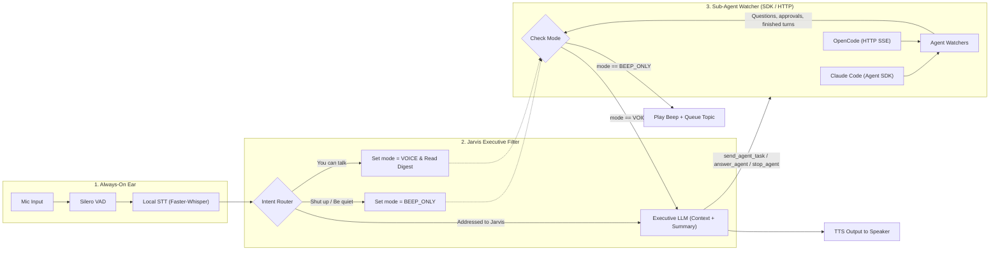

# Jarvis — Architecture & Technology Plan

## 1. Core Requirements

1. **Always-On (No Wake Word), Respond Only When Needed:** Continuously listen without requiring *"Hey Jarvis"*, while distinguishing between self-talk/background conversation and utterances actually addressed to Jarvis.
2. **Multi-Agent Orchestration:** Continuously watch and orchestrate coding agents including **Claude Code** and **OpenCode**.
3. **Executive Filtering (Jargon-Free):** Coding agent outputs are typically long and full of stack traces, diffs, and file paths. Jarvis must understand the context first, filter out routine progress, and surface only key blockers or architectural trade-offs that require the user's attention or decision.
4. **Dynamic Silence / Notification Mode:**
   - Saying **"Shut up"** or **"Be quiet"** immediately silences Jarvis's voice (`BEEP_ONLY` mode), interrupting any active speech and using short audio chimes ("beep") to notify when new agent decisions arrive.
   - Saying **"You can talk"** restores `VOICE` mode and reads out a concise digest of queued topics.

---

## 2. System Architecture Diagram

---

## 3. Recommended Stack & Rationale

### A. Real-Time Voice Pipeline Framework
* **[Pipecat](https://github.com/pipecat-ai/pipecat) (Python) — *Selected***
  * **Why:** Frame-based architecture makes it trivial to insert custom gates (`JarvisIntentGate`) directly into the audio/transcription stream. Supports instant interruption (`InterruptionFrame`), raw PCM beep injection (`OutputAudioRawFrame`), and direct TTS synthesis (`TTSSpeakFrame`).
* **Alternative:** **[LiveKit Agents](https://github.com/livekit/agents)** (WebRTC-focused with an open-weight Semantic Turn Detector).

### B. "No Wake Word"
Without a wake word, two local filtering stages prevent false triggers and API cost blowups:
1. **VAD (Voice Activity Detection):** **[Silero VAD](https://github.com/snakers4/silero-vad)** detects human speech boundaries locally in `<1ms`.
2. **Local Always-On STT + Turn Classifier:** **[MLX Whisper](https://github.com/ml-explore/mlx-examples/tree/main/whisper)** (`mlx-community/distil-whisper-large-v3`) transcribes speech locally on the Apple GPU at $0 cost. Fixed phrases ("shut up", "you can talk") are caught by a local pattern; everything else goes to the OpenRouter decision model `typesafe/jev-1.14` (`POST /api/alpha/decisions`, one `choice` question), which labels it `MUTE`, `UNMUTE`, `ADDRESSED_TO_JARVIS`, or `IGNORE_BACKGROUND` in about 230 ms.

### C. Coding Agent Integration (Claude Code, OpenCode)
Instead of fragile terminal/tmux scraping, Jarvis connects via structured JSON protocols:
Each agent has three actions, one LLM tool each: `send_agent_task` (new work), `answer_agent` (reply to the question
or approval the agent is waiting on) and `stop_agent`. An answer never becomes a new prompt, and a task never answers
a pending question.

1. **Claude Code (`ClaudeCodeAdapter`):** One long-lived `ClaudeSDKClient` (Python `claude-agent-sdk`) with
   `permission_mode="acceptEdits"` and the user's Claude settings. Tool permissions and `AskUserQuestion` arrive in
   `can_use_tool`; Jarvis reads them out and the agent waits for `answer_agent`. A turn ends with a `ResultMessage`.
   `stop_agent` calls `interrupt()` and denies any pending question.
2. **OpenCode (`OpenCodeSSEAdapter`):** Talks to a user-started `opencode serve` with HTTP Basic auth (`opencode` /
   `OPENCODE_SERVER_PASSWORD`). Events come from `GET /api/event`; 45 s without bytes (heartbeats arrive every 15 s)
   means a dead stream and a reconnect. After each connect it re-reads `GET /api/permission/request` and
   `GET /api/form`, since events are not replayed. It surfaces `permission.asked`, `form.created` and the last text of
   each finished run, and drops a pending request on `permission.replied`, `form.replied` or `form.cancelled`.
   Tasks go to the latest session (`POST /api/session/:id/prompt`), or a new one from `POST /api/session`; answers go to
   `.../permission/:requestID/reply` or `.../form/:formID/reply`; stop is `POST /api/session/:id/interrupt`.

### D. Executive Filter & Mute State Machine
1. **What reaches the user:** Watchers only pass on questions, approvals and finished turns. Questions and approvals
   are spoken as they are. A finished turn (long markdown) goes to the executive LLM as an `AGENT_REPORT_PROMPT`
   message, which retells it in two sentences and calls no tool; approvals never go through the LLM, so it can't
   approve anything on its own. Offline, Jarvis reads the turn's last line.
2. **Mute / Beep State Machine (`JarvisState`):**
   * **`VOICE` Mode:** Important agent topics are spoken immediately via TTS.
   * **`BEEP_ONLY` Mode (triggered by *"Shut up"* / *"Be quiet"*):** Active TTS is immediately cancelled, a low confirmation tone plays, and incoming agent topics are appended to `pending_topics` while playing a short 880Hz sine chime.
   * **Unmute Digest (triggered by *"You can talk"*):** Restores `VOICE` mode, reads out queued questions, then has the LLM retell queued finished turns.

---

## 4. Codebase Mapping

| Module | Path | Responsibility |
| :--- | :--- | :--- |
| **Main Pipeline** | `src/jarvis/main.py` | Wires Silero VAD, MLX Whisper, Intent Gate, Executive LLM (OpenRouter, DeepSeek V4.1 Flash; also retells finished turns), ElevenLabs TTS, and Agent Watchers. |
| **State & Beep Synth** | `src/jarvis/state.py` | `JarvisState` (`VOICE` vs `BEEP_ONLY`), regex fast-intent detection, and 16-bit PCM sine beep generator. |
| **Executive Filter** | `src/jarvis/executive_filter.py` | `typesafe/jev-1.14` (`FILTER_MODEL`) classifies whether speech is addressed to Jarvis. |
| **Voice Gates** | `src/jarvis/voice_gates.py` | Pipecat `FrameProcessor` implementation: `JarvisIntentGate`. |
| **Agent Watchers** | `src/jarvis/agent_watchers.py` | `ClaudeCodeAdapter`, `OpenCodeSSEAdapter`, and `AgentOrchestrator`. |
