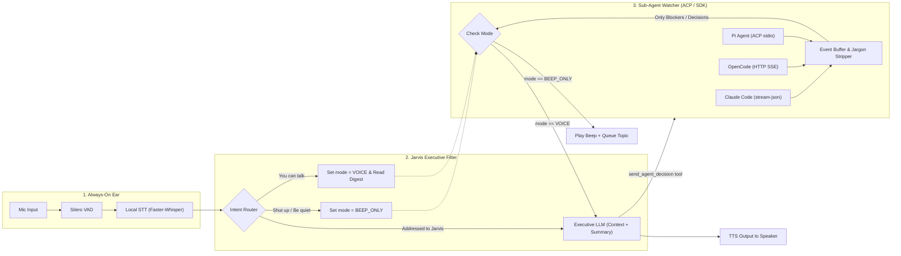

# Jarvis — Architecture & Technology Plan

## 1. Core Requirements

1. **Always-On (No Wake Word), Respond Only When Needed:** Continuously listen without requiring *"Hey Jarvis"*, while distinguishing between self-talk/background conversation and utterances actually addressed to Jarvis.
2. **Multi-Agent Orchestration:** Continuously watch and orchestrate coding agents including **Claude Code**, **OpenCode**, and **Pi**.
3. **Executive Filtering (Jargon-Free):** Coding agent outputs are typically long and full of stack traces, diffs, and file paths. Jarvis must understand the context first, filter out routine progress, and surface only key blockers or architectural trade-offs that require the user's attention or decision.
4. **Dynamic Silence / Notification Mode:**
   - Saying **"Shut up"** or **"Be quiet"** immediately silences Jarvis's voice (`BEEP_ONLY` mode), interrupting any active speech and using short audio chimes ("beep") to notify when new agent decisions arrive.
   - Saying **"You can talk"** restores `VOICE` mode and reads out a concise digest of queued topics.

---

## 2. System Architecture Diagram

---

## 3. Recommended Stack & Rationale

### A. Real-Time Voice Pipeline Framework
* **[Pipecat](https://github.com/pipecat-ai/pipecat) (Python) — *Selected***
  * **Why:** Frame-based architecture makes it trivial to insert custom gates (`JarvisIntentGate`) directly into the audio/transcription stream. Supports instant interruption (`InterruptionFrame`), raw PCM beep injection (`OutputAudioRawFrame`), and direct TTS synthesis (`TTSSpeakFrame`).
* **Alternative:** **[LiveKit Agents](https://github.com/livekit/agents)** (WebRTC-focused with an open-weight Semantic Turn Detector).

### B. "No Wake Word"
Without a wake word, two local filtering stages prevent false triggers and API cost blowups:
1. **VAD (Voice Activity Detection):** **[Silero VAD](https://github.com/snakers4/silero-vad)** detects human speech boundaries locally in `<1ms`.
2. **Local Always-On STT + Turn Classifier:** **[Faster-Whisper](https://github.com/SYSTRAN/faster-whisper)** (`distil-large-v3`) transcribes speech locally at $0 cost. A fast classifier then labels the transcript as `MUTE`, `UNMUTE`, `ADDRESSED_TO_JARVIS`, or `IGNORE_BACKGROUND`.

### C. Coding Agent Integration (Claude Code, OpenCode, Pi)
Instead of fragile terminal/tmux scraping, Jarvis connects via structured JSON protocols:
1. **Claude Code (`ClaudeCodeStreamAdapter`):** Spawned with `claude -p --output-format stream-json --input-format stream-json --verbose --permission-mode acceptEdits`. Questions and turn results are surfaced; tool permission prompts are not answered yet.
2. **Pi & ACP Agents (`ACPStdioAdapter`):** Connected via the **[Agent Client Protocol (ACP)](https://agentclientprotocol.com/)** over JSON-RPC 2.0 stdio (`pi --acp`). Jarvis sends `initialize` and `session/new`, prompts with `session/prompt`, collects `agent_message_chunk` updates until the prompt response (`stopReason`) ends the turn, and answers `session/request_permission` by picking an allow or reject option.
3. **OpenCode (`OpenCodeSSEAdapter`):** Subscribes to the OpenCode v2 server (`opencode serve`) at `GET /api/event` with HTTP Basic auth (`opencode` / `OPENCODE_SERVER_PASSWORD`). Surfaces `permission.asked` and the last text of each finished run (`session.execution.succeeded` / `failed`), answers permissions with `POST /api/session/:id/permission/:requestID/reply`, and sends instructions with `POST /api/session/:id/prompt`.

### D. Executive Filter & Mute State Machine
1. **Jargon Stripper (`ExecutiveFilter.evaluate_agent_event`):**
   * Routine events (file reads, passing tests, intermediate edits) return `should_interrupt: false` and are silently ignored.
   * Blockers, permission prompts, or architectural trade-offs return `should_interrupt: true` with a 1–2 sentence spoken summary stripped of file paths, stack traces, and code blocks.
2. **Mute / Beep State Machine (`JarvisState`):**
   * **`VOICE` Mode:** Important agent topics are spoken immediately via TTS.
   * **`BEEP_ONLY` Mode (triggered by *"Shut up"* / *"Be quiet"*):** Active TTS is immediately cancelled, a low confirmation tone plays, and incoming agent topics are appended to `pending_topics` while playing a short 880Hz sine chime.
   * **Unmute Digest (triggered by *"You can talk"*):** Restores `VOICE` mode and immediately reads out all queued topics from `pending_topics`.

---

## 4. Codebase Mapping

| Module | Path | Responsibility |
| :--- | :--- | :--- |
| **Main Pipeline** | `src/jarvis/main.py` | Wires Silero VAD, Faster-Whisper, Intent Gate, Executive LLM (OpenRouter, DeepSeek V4.1 Flash), ElevenLabs TTS, and Agent Watchers. |
| **State & Beep Synth** | `src/jarvis/state.py` | `JarvisState` (`VOICE` vs `BEEP_ONLY`), regex fast-intent detection, and 16-bit PCM sine beep generator. |
| **Executive Filter** | `src/jarvis/executive_filter.py` | DeepSeek V4.1 Flash via OpenRouter (thinking off) that strips technical jargon and classifies whether un-waked speech is addressed to Jarvis. |
| **Voice Gates** | `src/jarvis/voice_gates.py` | Pipecat `FrameProcessor` implementation: `JarvisIntentGate`. |
| **Agent Watchers** | `src/jarvis/agent_watchers.py` | `ClaudeCodeStreamAdapter`, `ACPStdioAdapter` (Pi), `OpenCodeSSEAdapter`, and `AgentOrchestrator`. |
